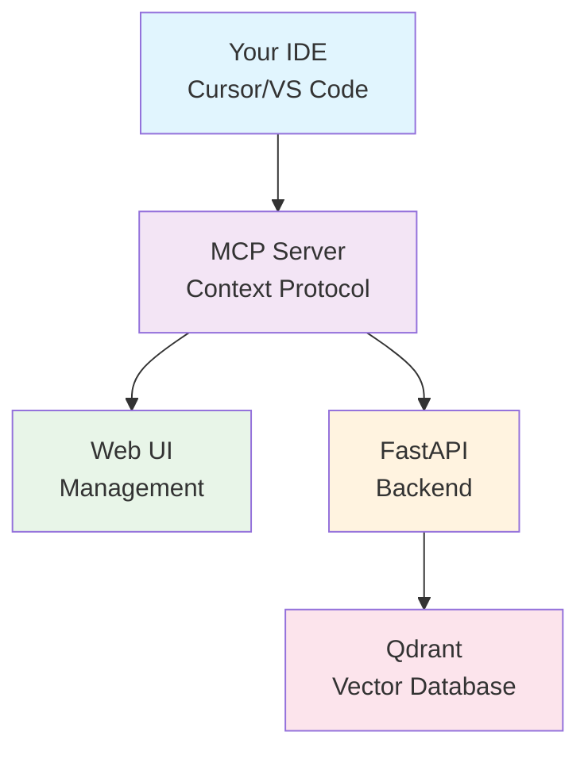

# open-context7

[中文](docs/README-zh.md)

> 🔒 Self-hosted, privacy-first alternative to Context7 for private code documentation

[](https://opensource.org/licenses/MIT)
[](https://www.docker.com/)

## Why open-context7?

Context7 is great, but it sends your code to external servers. **open-context7** keeps everything on your own infrastructure:

- 🔒 **Privacy First** - Your code never leaves your network
- 💰 **Completely Free** - No usage limits or subscription fees  
- 🛠️ **Fully Customizable** - Open source, modify as needed
- 🚀 **Easy Setup** - Start in 3 minutes with Docker Compose

## Quick Start

```bash
# Clone the project
git clone https://github.com/rakuv3r/open-context7.git
cd open-context7

# Setup backend configuration
# Get .env.example from API repo and configure it
curl -o .env.example https://raw.githubusercontent.com/rakuv3r/open-context7-api/main/.env.example
cp .env.example .env.dev
# Edit .env.dev with your settings

# Start all services
docker-compose up -d

# Access the application
open http://localhost
```

That's it! 🎉

## Architecture



## Services

All services are accessible through nginx reverse proxy:

- **Web UI** (`http://localhost/`) - Manage repositories and settings
- **API** (`http://localhost/api/`) - RESTful API for all operations
- **Qdrant** (`http://localhost/qdrant/`) - Vector database dashboard
- **MCP Server** - Model Context Protocol integration
- **Nginx** - Reverse proxy and load balancer

## IDE Integration

### Cursor IDE
1. Open Cursor settings
2. Add MCP server configuration:
```json
{
  "mcpServers": {
    "open-context7": {
      "command": "npx",
      "args": ["-y", "@rakuv3r/open-context7-mcp"],
      "env": {
        "CONTEXT7_API_BASE_URL": "http://localhost/api"
      }
    }
  }
}
```

## Project Structure

This is the main repository that orchestrates three components:

- **[open-context7-web](https://github.com/rakuv3r/open-context7-web)** - Next.js frontend
- **[open-context7-api](https://github.com/rakuv3r/open-context7-api)** - FastAPI backend
- **[open-context7-mcp](https://github.com/rakuv3r/open-context7-mcp)** - MCP server implementation

## Configuration

Default ports:
- Web UI: `3000`
- API: `8000`  
- Qdrant: `6333`

To customize, edit the `docker-compose.yml` file.

## License

[LICENSE](LICENSE)

---

**Star this project if you find it useful! ⭐**
