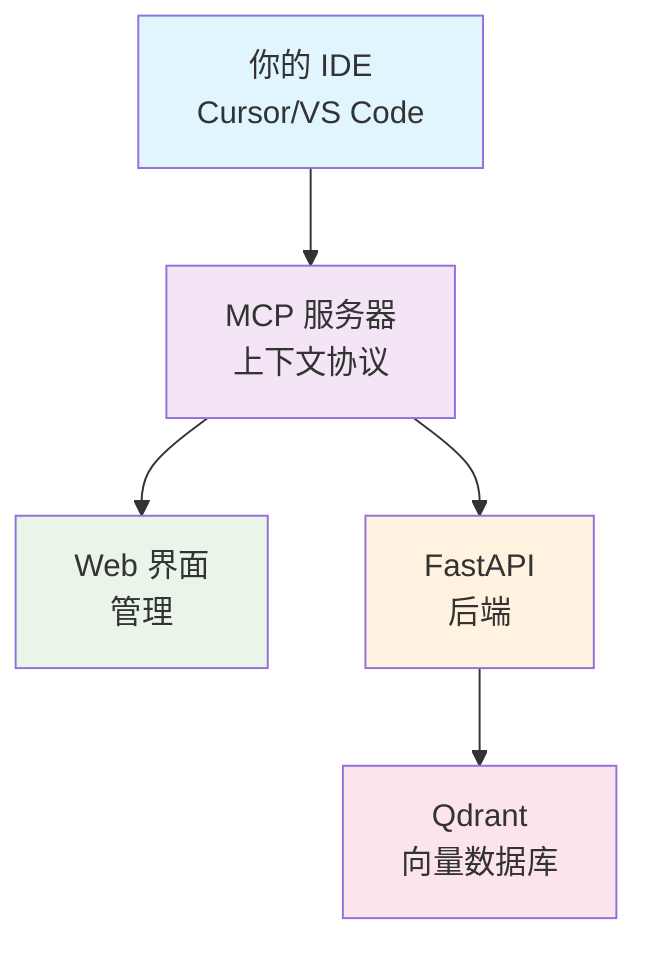

# open-context7

[English](../README.md)

> 🔒 可私有部署、隐私优先的 Context7 开源替代品

[](https://opensource.org/licenses/MIT)
[](https://www.docker.com/)

## 为什么选择 open-context7？

Context7 很好用，但它会将你的代码发送到外部服务器。**open-context7** 将所有数据保留在你自己的基础设施上：

- 🔒 **隐私优先** - 你的代码永远不离开你的网络
- 💰 **完全免费** - 没有使用限制或订阅费用
- 🛠️ **完全可定制** - 开源，可按需修改
- 🚀 **简单部署** - 3 分钟内用 Docker Compose 启动

## 快速开始

```bash
# 克隆项目
git clone https://github.com/rakuv3r/open-context7.git
cd open-context7

# 配置后端
# 从 API 仓库获取配置模板并设置
curl -o .env.example https://raw.githubusercontent.com/rakuv3r/open-context7-api/main/.env.example
cp .env.example .env.dev
# 编辑 .env.dev 文件，设置你的配置

# 启动所有服务
docker-compose up -d

# 访问应用
open http://localhost
```

就是这么简单！🎉

## 系统架构



## 服务说明

所有服务通过 nginx 反向代理访问：

- **Web 界面** (`http://localhost/`) - 管理代码仓库和设置
- **API 服务** (`http://localhost/api/`) - 提供所有操作的 RESTful API
- **Qdrant** (`http://localhost/qdrant/`) - 向量数据库管理界面
- **MCP 服务器** - Model Context Protocol 集成
- **Nginx** - 反向代理和负载均衡

## IDE 集成

### Cursor IDE
1. 打开 Cursor 设置
2. 添加 MCP 服务器配置：
```json
{
  "mcpServers": {
    "open-context7": {
      "command": "npx",
      "args": ["-y", "@rakuv3r/open-context7-mcp"],
      "env": {
        "CONTEXT7_API_BASE_URL": "http://localhost/api"
      }
    }
  }
}
```

## 项目结构

这是主仓库，协调以下三个组件：

- **[open-context7-web](https://github.com/rakuv3r/open-context7-web)** - Next.js 前端
- **[open-context7-api](https://github.com/rakuv3r/open-context7-api)** - FastAPI 后端
- **[open-context7-mcp](https://github.com/rakuv3r/open-context7-mcp)** - MCP 服务器实现

## 配置

默认端口：
- Web 界面: `3000`
- API 服务: `8000`  
- Qdrant: `6333`

如需自定义，请编辑 `docker-compose.yml` 文件。

## 许可证

[LICENSE](../LICENSE)

---

**如果这个项目对你有用，请给个 Star！⭐**